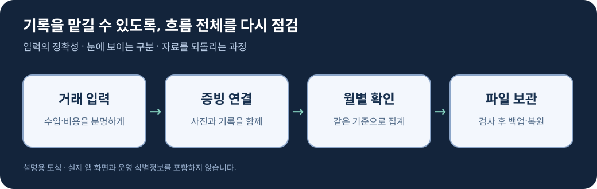

# 첫 수익이 다시 시작하게 만든 앱 개편

> 수입·비용과 영수증을 기록하는 Android 앱을 만들고, 첫 수익을 계기로 다시 손본 기록입니다.

## 다시 고치게 된 계기

예전에 만들어 둔 앱이 있습니다. 개인사업자와 프리랜서가 수입과 비용을 기록하고 영수증을 정리하는 앱입니다.

그러다 앱을 만든 이후 **처음으로 수익이 발생한 것을 확인했습니다.** 금액 자체보다도, 누군가 실제로 돈을 내고 제가 만든 앱을 선택했다는 사실이 이번 업데이트의 계기가 됐습니다.

다시 열어 보니 처음 만들 때는 지나쳤던 부분들이 보였습니다. 배경과 잘 구분되지 않는 버튼과 카드, 한 번 더 생각해야 하는 입력 흐름, 기록을 옮기거나 되돌릴 때 부족했던 처리들이 있었습니다.

그래서 화면 몇 개만 바꾸는 대신, 기록을 입력하고 확인하고 보관하는 전체 흐름을 다시 점검했습니다. 첫 수익을 기념하는 방법으로, 앱을 더 잘 쓰일 수 있게 고치는 일을 선택했습니다.

## 어떤 앱인가요?

- 월별 수입·비용을 입력하고 검색하는 기록 도구
- 거래와 영수증 사진을 연결해 보관하는 증빙 도구
- 한 달의 흐름을 확인하고 자료를 내보내는 정리 도구
- 기기 안의 기록을 파일로 백업하고 복원하는 관리 도구

자동 세무 신고나 확정 세액 산출 서비스가 아닌, 사용자가 자신의 기록을 관리하는 앱입니다.

## 이번에 바꾼 것

| 영역 | 개선한 내용 |
|---|---|
| 화면 구분 | 카드·버튼·입력창의 테두리와 배경 대비를 강화하고 선택 상태를 선명하게 표시 |
| 기록 흐름 | 수입·비용 입력 진입, 거래 검색·필터·복제, 입력 중 화면 전환과 회전 처리 개선 |
| 합계와 보고서 | 월별·사업장별 기록을 일관되게 집계하고, 데이터가 부족할 때 단정적인 분석을 하지 않도록 정리 |
| 영수증 | 거래와 사진 연결, 미연결 증빙 확인, 기기 내 문자 인식 후 사용자 확인 흐름 추가 |
| 보관과 이동 | 사진 포함 백업, 선택적 암호화, 복원 전 검사와 미리보기, CSV 가져오기·내보내기 |
| 일상 사용 | 반복 예정 기록, 화면 테마, 앱 잠금, 빠른 입력 위젯과 알림 설정 정리 |
| 등록정보 | 바뀐 기능에 맞춰 소개 문구와 시각 자료 갱신 |

자세한 작업 기록은 [개편 노트](docs/renewal-notes.md)에 정리했습니다.

## 검증과 현재 상태

원본 프로젝트에서는 월별 집계, 데이터 이전, 백업·복원, CSV, 증빙 연결 등을 대상으로 단위 테스트 19개와 에뮬레이터 테스트 8개를 통과했습니다. 배포 빌드와 린트 검사도 완료했습니다.

2026년 10월 28일 기준 새 버전과 등록정보의 검토 요청을 마친 상태입니다. 실제 스토어 공개 시점은 심사 결과에 따릅니다. 이 저장소에는 원본 앱의 테스트 결과 파일이나 콘솔 화면을 포함하지 않습니다.

## 공개한 코드

[MonthlySummaryExample.kt](examples/MonthlySummaryExample.kt)는 월별 집계에서 지켜야 할 기본 원리를 설명하기 위해 별도로 작성한 작은 예제입니다. 실제 앱의 핵심 구현을 옮긴 코드가 아닙니다.

- 선택한 월에 속하는 거래만 계산
- 수입과 비용을 나눠 합산
- 기록이 없는 달은 0으로 처리

이 저장소는 개편 과정과 학습용 예제를 공개하는 기록이며, 실제 배포 앱을 빌드할 수 있는 전체 프로젝트는 아닙니다. 예제 데이터와 도식은 설명을 위해 만든 것입니다.

## 공개 범위

앱을 특정할 수 있는 이름·패키지명·스토어 링크·로고·실제 스크린샷은 공개하지 않습니다. 운영 식별자, 서명 자료, 계정 정보, 사용자 거래 자료와 중요한 서비스 구현도 포함하지 않습니다. 자세한 범위는 [공개 자료 안내](docs/publication-scope.md)를 참고하세요.
